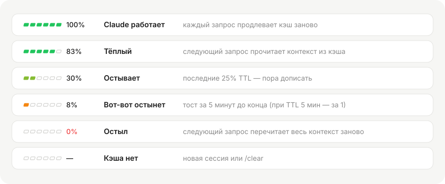
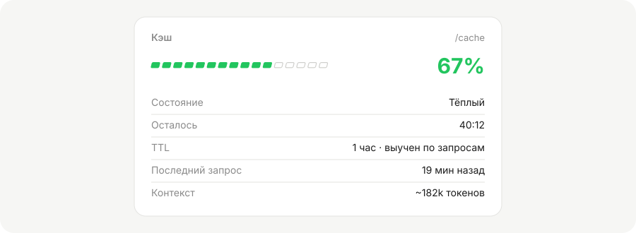

<div align="center">

<picture>
  <source media="(prefers-color-scheme: dark)" srcset="docs/assets/hero-dark.svg">
  
</picture>

<h3>Видно, когда prompt-кэш остывает, ещё до того, как следующий запрос перечитает весь контекст.</h3>

[](https://docs.claude.com/en/docs/claude-code)
[](.claude-plugin/plugin.json)
[](LICENSE)


[Установка](#установка) · [Состояния](#состояния) · [Подробности](#подробности-cache) · [Как считается TTL](#как-считается-ttl) · [Разработка](#разработка)

</div>

---

## Зачем

Claude Code кэширует контекст сессии: системный промпт, историю, файлы. Пока кэш тёплый, каждый следующий запрос читает контекст из кэша, и ответ приходит быстрее, а лимиты тратятся медленнее. Если сделать паузу дольше TTL (обычно час, в overage 5 минут), кэш умирает. Тогда следующее сообщение заново отправит весь контекст, на длинной сессии это сотни тысяч токенов.

**cache-band** показывает это время прямо в интерфейсе: маленькая капсула в строке под полем ввода, рядом с моделью и режимом.

- **`▰▰▰▰▰▱ 83%`** — сколько процентов TTL осталось, цвет меняется от зелёного к жёлтому и оранжевому.
- **Тост** за 5 минут до остывания, чтобы успеть дописать (при TTL 5 минут — за 1 минуту).
- **`/cache`** — карточка с подробностями: сколько осталось, TTL и откуда он известен, размер контекста.
- **Ноль зависимостей и настроек**: один модуль хуков, всё считается локально по ответам API.

## Установка

В терминальной сессии Claude Code:

```
/plugin install cache-band --marketplace privatekey7/cache-band
```

Или из shell:

```bash
claude plugin install cache-band --marketplace privatekey7/cache-band
```

На вопрос `Add marketplace?` ответь `y`, затем выбери scope: **user** включит мод во всех сессиях.

<details>
<summary>В десктоп-приложении Claude</summary>

Там `/plugin` не работает. Нажми **+** рядом с полем ввода → **Plugins** → **Add marketplace** → `privatekey7/cache-band` → **Add plugin**.

</details>

## Состояния

<picture>
  <source media="(prefers-color-scheme: dark)" srcset="docs/assets/states-dark.svg">
  
</picture>

| Капсула | Что значит |
| --- | --- |
| зелёная `100%` | Claude отвечает, каждый запрос продлевает кэш |
| зелёная | кэш тёплый |
| жёлтая | последние 25% TTL |
| оранжевая | вот-вот остынет, пришёл тост |
| красная `0%` | остыл: смена модели и сжатие контекста тоже сразу делают его таким |
| серая `—` | кэша ещё нет: новая сессия или `/clear` |

## Подробности: `/cache`

<picture>
  <source media="(prefers-color-scheme: dark)" srcset="docs/assets/pane-dark.svg">
  
</picture>

Команда `/cache` открывает панель рядом с чатом. Она обновляется каждую секунду, а для остывшего кэша показывает, сколько токенов перечитает следующий запрос.

## Как считается TTL

Отсчёт идёт от последнего запроса основной сессии. Запросы субагентов не считаются: у них свой кэш, кэш основной сессии они не продлевают.

TTL мод определяет сам, по порядку надёжности:

1. **Overage.** Если лимит за 5 часов или за неделю исчерпан, TTL 5 минут.
2. **Смена модели.** Движок в этот момент сам сообщает TTL.
3. **Обучение.** После паузы дольше 5 минут: если кэш прочитался, TTL 1 час, если промахнулся, 5 минут.
4. **По умолчанию** 1 час.

Откуда известен TTL сейчас, видно в `/cache`.

## Где работает

| Поверхность | Капсула | `/cache` |
| --- | :---: | :---: |
| Claude Code в терминале | ✅ | ✅ |
| Десктоп-приложение (вкладка Code) | ✅ | ✅ |
| VS Code, мобильное приложение | — | — |

## Разработка

```bash
git clone https://github.com/privatekey7/cache-band && cd cache-band
claude --plugin-dir .                 # сессия с модом из этой папки
claude plugin validate .              # манифест и хуки
claude plugin test .                  # 12 тестов: логика, вид, отрисовка
npx -p typescript@5.8.3 tsc -p .      # типы (движок кладёт их в .claude-plugin/types/ при загрузке)
python scripts/render_assets.py       # перерисовать картинки для README
```

```
hooks/
  register.tsx   хуки: запросы, смена модели, сжатие, отрисовка строки и панели
  cache.ts       чистая логика: TTL, остаток, обучение, цвет
  view.ts        чистый вид: проценты, сегменты, строки панели
tests/           тесты на логику, вид и отрисовку в терминале и десктопе
scripts/         генератор SVG для README (цвета взяты из cache.ts)
```

## Лицензия

[MIT](LICENSE) © privatekey7
